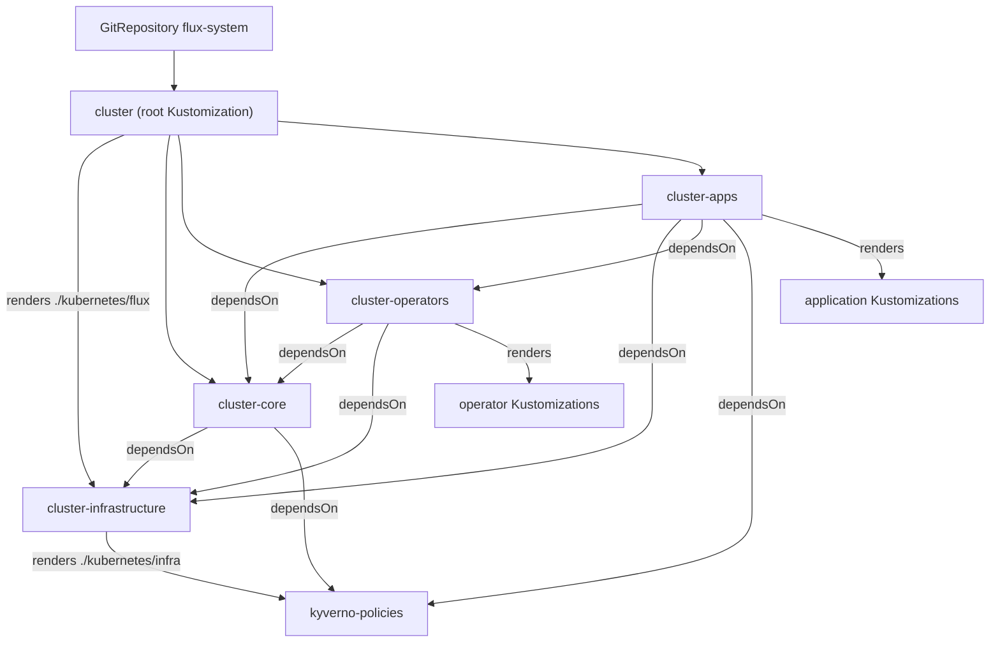
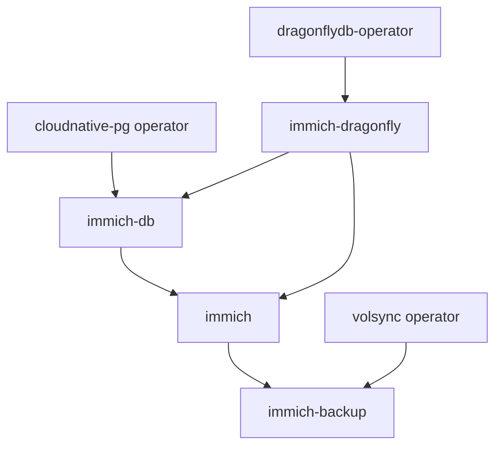

# How Applications Deploy: The Flux Deployment Model

This document explains how a manifest committed to this repository becomes a running workload. It's about the shape of the deployment model: the chain of Flux Kustomizations, why the layers depend on each other, and the conventions that let an application author write a short `ks.yaml` and still get secrets, variables, and ordering for free. It complements [Flux GitOps Workflow](../flux-gitops.md), which covers controller internals, troubleshooting, and secret handling, and [Kubernetes Applications](../kubernetes-applications.md), which inventories what actually runs.

## The problem: dependency-ordered GitOps

A home cluster is a pile of things that only work in a particular order. A PostgreSQL cluster can't come up before the CloudNative-PG operator installed its CRDs. An application that talks to that database can't start before the database exists. Policies that reject non-compliant workloads can't be enforced before the policy engine is running.

Flux doesn't infer any of that. It reconciles whatever Kustomizations you give it, and if you hand it everything at once, you get a race: HelmReleases fail because CRDs are missing, pods crash because a dependency isn't ready, and the cluster eventually settles only after a lot of retries and noise. The deployment model in this repository exists to remove that race. It expresses two ideas at once: a coarse ordering between whole layers of the stack, and a fine ordering between the individual pieces inside a layer.

## Bootstrap: from one Kustomization to four layers

Everything starts from a single bootstrap command, run once by hand because Flux can't manage itself before it's running:

```
make cluster-install
```

That target installs the Flux controllers from `kubernetes/bootstrap`, stores your age key as the `sops-age` secret, applies the cluster settings and decrypted cluster secrets, and finally runs `kubectl apply --kustomize kubernetes/flux/config`. The result is the root Flux Kustomization defined in `kubernetes/flux/config/cluster.yaml`:

```yaml
metadata:
  name: cluster
  namespace: flux-system
spec:
  path: ./kubernetes/flux
  sourceRef:
    kind: GitRepository
    name: flux-system
  decryption:
    provider: sops
    secretRef:
      name: sops-age
```

From here on Flux owns the cluster. The `cluster` Kustomization watches `./kubernetes/flux`, and that directory holds four sibling Kustomizations that split the stack into layers. Each points at a top-level directory:

| Flux Kustomization | Path | Role |
|---|---|---|
| `cluster-infrastructure` | `./kubernetes/infra` | CNI, storage, service mesh, monitoring, policy |
| `cluster-core` | `./kubernetes/core` | Platform services such as Harbor and Tekton |
| `cluster-operators` | `./kubernetes/operators` | CRDs and controllers |
| `cluster-apps` | `./kubernetes/apps` | User-facing applications |

The whole chain, as Flux sees it, looks like this:



Every Flux Kustomization lives in `flux-system`, wherever it's declared. Workloads land in the right namespace because each app or component Kustomization sets `spec.targetNamespace`, and its `sourceRef` points at the same `GitRepository`. Flux does not scatter.

## Why the layers depend on each other

`dependsOn` is Flux's ordering primitive, and the layer files use it to encode the natural build order of the cluster:

- `cluster-infrastructure` declares nothing. It goes first because everything else assumes networking, storage, and the service mesh exist.
- `cluster-core` depends on `cluster-infrastructure` and on `kyverno-policies`.
- `cluster-operators` depends on `cluster-core` and `cluster-infrastructure`.
- `cluster-apps` depends on `cluster-core`, `cluster-infrastructure`, `cluster-operators`, and `kyverno-policies`.

The `kyverno-policies` edge is the interesting one. It isn't a directory. It's a Kustomization named `kyverno-policies` that lives in `kubernetes/infra/kyverno-system/kyverno/ks.yaml`, right beside the `kyverno` Kustomization that installs the engine itself:

```yaml
kind: Kustomization
metadata:
  name: kyverno-policies
  namespace: flux-system
spec:
  dependsOn:
    - name: kyverno
  path: ./kubernetes/infra/kyverno-system/kyverno/policies
```

That single file shows a layer emitting Kustomizations that other layers depend on. `cluster-infrastructure` renders `./kubernetes/infra`, which produces `kyverno` and `kyverno-policies` as separate namespaced objects. `cluster-core` and `cluster-apps` then declare a dependency on the second one by name. The effect is that policy is loaded before core services and before apps, without policy being a "layer" of its own. Dependency wiring follows object names, not directory boundaries.

One consequence of `dependsOn` is worth internalizing: a dependency is treated as satisfied once the target Kustomization reports ready, not once every pod it created is healthy. That's why individual components also set `wait: true` with a `timeout` when they need to guarantee readiness for downstream consumers, a pattern visible throughout `kubernetes/apps`.

## Discovery: why there is no index of apps

`kubernetes/apps` has no root `kustomization.yaml`, and neither does `kubernetes/flux`. That looks like an omission, but it's deliberate. When a Flux Kustomization points at a path with no `kustomization.yaml`, the kustomize controller generates one for the tree automatically, the equivalent of `kustomize create --autodetect --recursive`. It walks the directory, finds subdirectories that contain their own `kustomization.yaml`, and treats each as a resource.

So `cluster-apps` discovers every namespace directory under `kubernetes/apps` on its own. Each namespace index then lists its applications explicitly. The Immich namespace, for example, is a three-line index:

```yaml
kind: Kustomization
resources:
  - ./namespace.yaml
  - ./immich/ks.yaml
  - ./immich/backup/ks.yaml
```

The payoff is that adding a new application or a whole new namespace requires no edits under `kubernetes/flux`. Push the files, and the next reconcile finds them. The cost is discipline: the namespace `kustomization.yaml` is the one place that must be updated, and if a new `ks.yaml` isn't listed there, Flux will never see it. Auto-discovery happens above the namespace, not inside it.

The operators layer works the other way, and the contrast is instructive. `kubernetes/operators/kustomization.yaml` is an explicit index:

```yaml
resources:
  - ./cnpg-system
  - ./dragonflydb
  - ./volsync
  - ./rook-ceph
```

A new operator must be registered there or it stays invisible. The reasoning is that operators are relatively rare, carefully ordered, and often carry cluster-scoped CRDs, so a human checkpoint at the directory level is worth the extra edit. Applications are numerous and frequently added, so discovery is automated instead.

The same loose-file behavior applies to `kubernetes/flux` itself. The four layer files sit directly in that directory with no index, and the root `cluster` Kustomization picks them up automatically.

## Inheritance: decryption and variables for free

An application `ks.yaml` is deliberately thin. It never declares `spec.decryption` and never declares `spec.postBuild`. Both are injected. To see how, look at any layer file, such as `kubernetes/flux/apps.yaml`. After its own `dependsOn` list, it ends with a `patches` entry whose target selects rendered Flux Kustomizations:

```yaml
patches:
  - patch: |-
      apiVersion: kustomize.toolkit.fluxcd.io/v1
      kind: Kustomization
      metadata:
        name: not-used
      spec:
        decryption:
          provider: sops
          secretRef:
            name: sops-age
        postBuild:
          substituteFrom:
            - kind: ConfigMap
              name: cluster-settings
            - kind: Secret
              name: cluster-secrets
            - kind: ConfigMap
              name: cluster-settings-user
            - kind: Secret
              name: cluster-secrets-user
    target:
      group: kustomize.toolkit.fluxcd.io
      kind: Kustomization
      labelSelector: substitution.flux.home.arpa/disabled notin (true)
```

The placeholder `name: not-used` is ignored for a label-selected patch. What matters is the selector: every Kustomization that comes out of the rendered tree, unless it opts out with the label `substitution.flux.home.arpa/disabled: "true"`, receives the same SOPS decryption and the same four substitution sources. Each layer file carries a copy of this patch, so the rule holds no matter which layer an app is discovered under.

This is why `${SECRET_DOMAIN}` and friends resolve inside application manifests. The app's own Kustomization is the object that performs variable substitution, and it gets its `substituteFrom` list handed to it by the layer above. The four sources are layered deliberately: `cluster-settings` and `cluster-secrets` hold defaults, while `cluster-settings-user` and `cluster-secrets-user` override them. Within a list, later sources win, so a user-provided value beats the committed default, and an undefined variable is substituted with an empty string unless the manifest supplies a default (`${VAR:=default}`). The root `cluster` Kustomization uses the same pattern with the two non-user sources only, because the user files don't exist until the bootstrap applies them.

The upshot for an app author is that decryption and substitution are repo-wide conventions, not per-app configuration. Enabling the mechanism once, at the layer, keeps every app's YAML small and consistent. The trade-off is implicit magic: an app manifest references a variable that isn't defined anywhere visible in its own directory, and the only place it's resolved is a patch in a file two levels up.

## Dependency chains inside an app

Layers give coarse ordering between directories. A single `ks.yaml` gives fine ordering between the pieces of one application, because it can hold several Kustomizations. Immich is the canonical example: `kubernetes/apps/immich/immich/ks.yaml` defines three Kustomizations, and they form a chain.

At the top, the `immich` Kustomization waits for its data services:

```yaml
metadata:
  name: &app immich
spec:
  targetNamespace: immich
  dependsOn:
    - name: immich-db
    - name: immich-dragonfly
```

The `immich-db` Kustomization depends on the `cloudnative-pg` operator so its `Cluster` custom resource has a CRD to attach to, and on `immich-dragonfly` as well. The `immich-dragonfly` Kustomization depends on `dragonflydb-operator`. The resulting diamond ensures the cache and database machinery exist before the application Kustomization applies its HelmRelease, and the YAML anchors (`&app`, `*app`) keep the repeated labels readable.



Backups follow the same reasoning in reverse. The `immich-backup` Kustomization, in `kubernetes/apps/immich/immich/backup/ks.yaml`, depends on the application it protects and on the `volsync` operator:

```yaml
dependsOn:
  - name: immich
  - name: volsync
    namespace: flux-system
```

Backing up a volume that hasn't been created yet is pointless, so the dependency points forward from the app to its protection. The dependency anchors are the operator Kustomizations, which is why `cloudnative-pg`, `dragonflydb-operator`, `volsync`, and `mariadb-operator` show up repeatedly in app files. They're the named handles an application author grabs to declare "this must be ready first."

## Design consequences

The model pushes most of its complexity into a few shared files, which means a small set of rules keeps it working.

Adding an application means creating `kubernetes/apps/<namespace>/<app>/ks.yaml`, its component directories, and a `namespace.yaml`, then registering the new `ks.yaml` in that namespace's `kustomization.yaml`. If the namespace is new, a `kustomization.yaml` in the namespace directory is what makes the controller discover it. Nothing under `kubernetes/flux` changes.

An application `ks.yaml` never declares `spec.decryption` or `spec.postBuild`. Those come from the layer patch. Writing them by hand duplicates the convention and drifts from it the first time a source is added.

No root `kustomization.yaml` belongs in `kubernetes/apps` or `kubernetes/flux`. Adding one would opt the tree out of auto-generation and turn every new app into a registration step. The one explicit index that does exist, `kubernetes/operators/kustomization.yaml`, is explicit on purpose, and a new operator must be added there.

Cross-cutting dependencies name the specific Kustomization that must be ready, using `dependsOn`, rather than assuming a layer is enough. Depending on all of `cluster-operators` is coarser than depending on `cloudnative-pg`, and the fine-grained edge is what lets unrelated operators install in parallel.

Two facts about the surrounding tooling are easy to get wrong. The Makefile is authoritative for commands; older notes in `README.md` and `CLAUDE.md` still show `task ...` invocations from the previous task runner, and the equivalent targets are now `make ...`. And validation is scoped: `make kubernetes-kubeconform` validates the standalone files and kustomizations under `kubernetes/flux`, plus the kustomizations under `kubernetes/apps`. It does not render or validate `kubernetes/operators`, `kubernetes/core`, or `kubernetes/infra`. Manifests in those layers are checked by Flux at reconcile time, not by that target, so a clean kubeconform run is not proof that an operator change is valid.

## Where to go next

To add an application using this model, follow [How to Add an Application](how-to-add-an-application.md). For the exact fields and directory layout of the files involved, see [Application Anatomy Reference](reference-app-anatomy.md), and for the variables that substitution resolves, see [Cluster Variables Reference](reference-cluster-variables.md). For the controllers, reconciliation, and secret-handling machinery underneath, read [Flux GitOps Workflow](../flux-gitops.md).

## Related documents

- [How to Add an Application](how-to-add-an-application.md)
- [Application Anatomy Reference](reference-app-anatomy.md)
- [Cluster Variables Reference](reference-cluster-variables.md)
- [Flux GitOps Workflow](../flux-gitops.md)
- [Kubernetes Applications](../kubernetes-applications.md)
